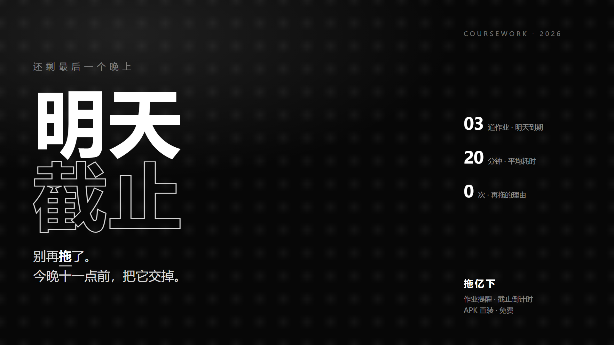
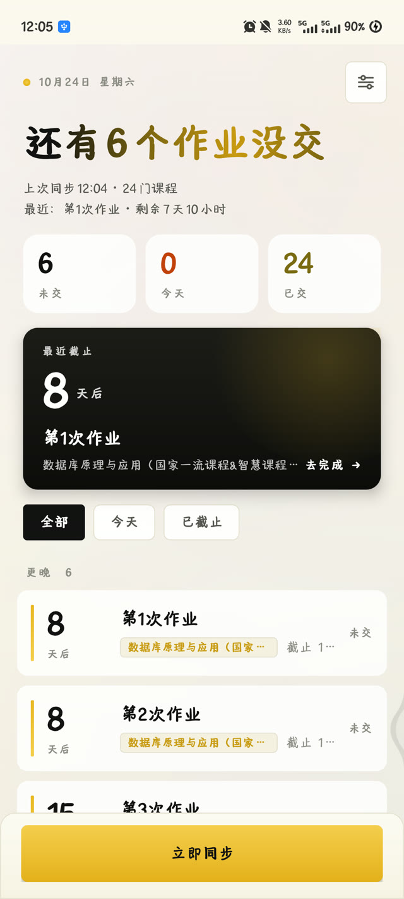
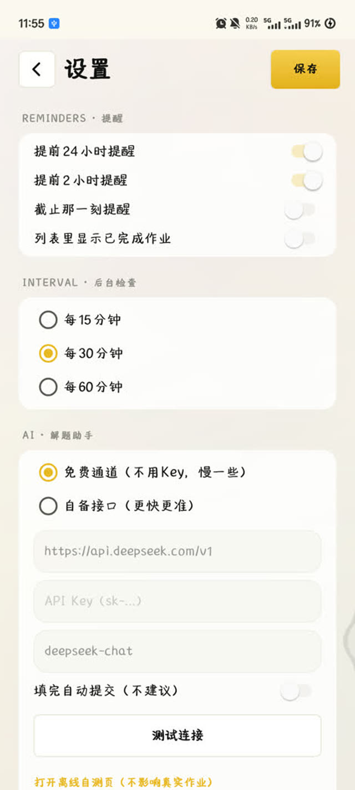
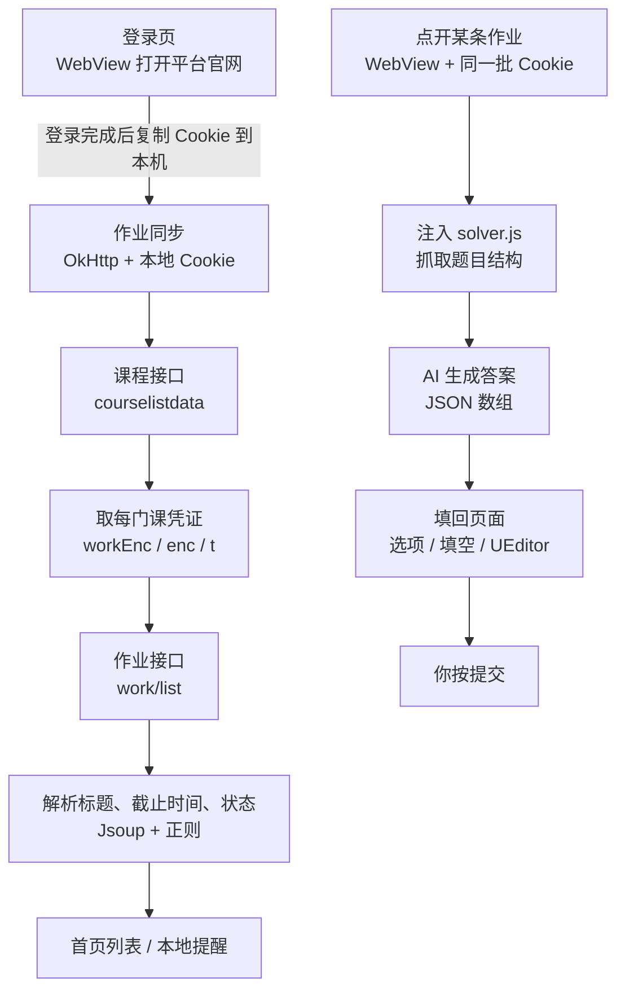

# 拖亿下 · tuoyixia

> 一个只做一件事的安卓小工具：**把散在各门课里的作业盯住，截止前提醒你；打开作业时，顺手帮你把题做了。**

<p align="center">
  
</p>

<p align="center">
  <a href="https://github.com/sqyCoder/tuoyixia/releases/latest">
    
  </a>
  <a href="https://github.com/sqyCoder/tuoyixia/stargazers">
    
  </a>
</p>

<p align="center">
  
  
  
  
</p>

---

## 为什么做它

作业散在十几门课里，截止时间各不相同，真正麻烦的不是"不会做"，而是**忘了交**。

拖亿下把这件事收拢成一屏：还有几个没交、哪个最急、还剩多久；打开某条作业时，它顺手把题也做了——但**提交永远由你按**。

---

## 功能

| | 功能 | 说明 |
|---|---|---|
| 📚 | 作业自动同步 | 一次拉到所有课程的作业、截止时间、提交状态（需登录学校课程平台） |
| ⏰ | 截止前提醒 | 按剩余时间分级提醒，可自定义提前量与频率 |
| 🎯 | 一屏看重点 | 未交 / 今天 / 已截止筛选，最近截止卡片显示倒计时 |
| ✍️ | 进作业自动作答 | 识别单选、多选、判断、填空、简答，AI 生成后自动填入 |
| 🔒 | 数据只在本机 | 没有服务器、没有统计、不上传账号 |

<p align="center">
  
  
</p>

---

## 使用方法

1. **下载安装**：点上面的按钮，或到 [Releases](https://github.com/sqyCoder/tuoyixia/releases) 下载 `tuoyixia-v1.0.5.apk`（约 3.2 MB），允许"安装未知来源应用"。
2. **登录**：首次打开会先弹用户协议，同意后进入登录页——在**课程平台的官方登录页**里正常登录，然后点"我已完成登录"。
3. **同步**：回到首页点「立即同步」，等它把作业拉下来（首次会逐门课取，稍慢）。
4. **设提醒**：设置里打开通知权限，设定提前提醒的时间。
5. **作答**：点任意一条作业 → 进入真实作业页 → 点「解题助手」→ 等答案填入 → **自己检查一遍** → 提交。

---

## 答案从哪来

两种通道，设置里切换：

**① 免费公共通道（默认）**
不需要任何 Key，开箱可用。走的是公共接口，高峰期会排队或限流，偶尔会提示"公共通道繁忙"，过一会儿重试即可。

**② 自备接口（推荐长期使用）**
任何 OpenAI 兼容接口都行：DeepSeek、硅基流动、智谱、通义、自建中转……

在「设置 → 解题助手」填三项：

```
Base URL   https://api.deepseek.com/v1
API Key    sk-xxxxxxxx
模型        deepseek-chat
```

> 题目文本会发送到**你填写的**服务商；选免费通道则发送到该公共接口。答案由模型生成，可能出错，**提交前请自行核对**。

---

## 工作原理



关键点：**不做模拟登录**。账号密码是在平台自己的页面里输入的，App 不接触；它只保存登录后的 Cookie，后续请求都带着这个 Cookie。所有答题、提交都在真实页面上完成，没有伪造接口。

---

## 自己构建

环境：JDK 17、Android SDK 34、Gradle 8.11（仓库自带 wrapper）。

```bash
git clone https://github.com/sqyCoder/tuoyixia.git
cd tuoyixia
./gradlew assembleDebug
# 产物：app/build/outputs/apk/debug/app-debug.apk
```

打包正式版请自行生成 keystore，并在 `app/build.gradle` 里配置 `signingConfigs`：

```bash
keytool -genkey -v -keystore release.jks -keyalg RSA -keysize 2048 -validity 10000 -alias tuoyixia
```

---

## 项目结构

```
app/src/main/
├── java/com/keepup/course/
│   ├── SplashActivity / LoginActivity / MainActivity
│   ├── WorkActivity          # 作业详情：WebView + 解题助手
│   ├── SettingsActivity / AgreementActivity
│   ├── SyncEngine · ChaoxingApi   # 同步与接口解析
│   ├── AiClient              # OpenAI 兼容客户端（含免费通道重试）
│   ├── Prefs · Http · CookieStore · Notifications
│   └── AuroraView · Ui       # 自绘背景与动效
├── assets/solver.js          # 抓题 / 填答案（注入作业页）
└── res/                      # 黄白黑视觉体系、三档尺寸
```

---

## 隐私与安全

- **没有服务器**：项目本身不接收任何数据，也没有埋点。
- **Cookie 存本机**：保存在 SharedPreferences，**明文**。它等同于登录凭证，请勿把手机借给他人，也不要导出分享。
- **卸载即清空**：课程、作业、答案缓存、Cookie 全部随应用删除。
- **答案缓存**：同一道题只问一次 AI，结果存在本地用于加速。

如果在意明文存储，可以自行改成 Android Keystore 加密（`Prefs` 里读写 `cookies` 的两个方法）。

---

## 已知限制

- **依赖网页版结构**：接口字段、页面选择器随平台改版可能失效，需要跟着更新。
- **只覆盖网页端能看到的作业**：App 内独有的互动、直播类任务抓不到。
- **附件题 / 编程题**不自动处理，需要手动完成。
- **免费通道会限流**：多人同时用同一出口 IP 时容易返回空，建议自备接口。
- **仅 Android 8.0+**，未适配平板大屏布局（会等比放大）。

---

## 免责声明

本项目仅供个人学习辅助，用于**管理自己的作业截止时间**与减少重复劳动。

- 请遵守所在学校的规定与所用平台的服务条款；
- AI 生成的答案仅供参考，**提交前必须自行核对**；
- 禁止用于代考、替学等违规用途，因使用产生的后果由使用者自行承担。

如果你所在的学校明确禁止此类工具，请不要使用。

---

## 更新记录

**v1.0.5**
- 文案去品牌化：登录、协议、提示统一改为「课程平台」

**v1.0.4**
- 免费通道改为多模型轮换 + 退避重试，修复部分用户"接口返回空答案"
- 失败时给出可操作弹窗（重试 / 去设置）
- 打包尺寸适配：按屏幕宽度分档放大关键尺寸

**v1.0.0**
- 移除课程学习模块，聚焦「作业提醒 + 自动作答」
- 新增用户协议与隐私说明（首次启动强制确认）
- 视觉重做：黄 / 白 / 黑，形状体系分层

---

## License

[MIT](LICENSE) © sqyCoder
